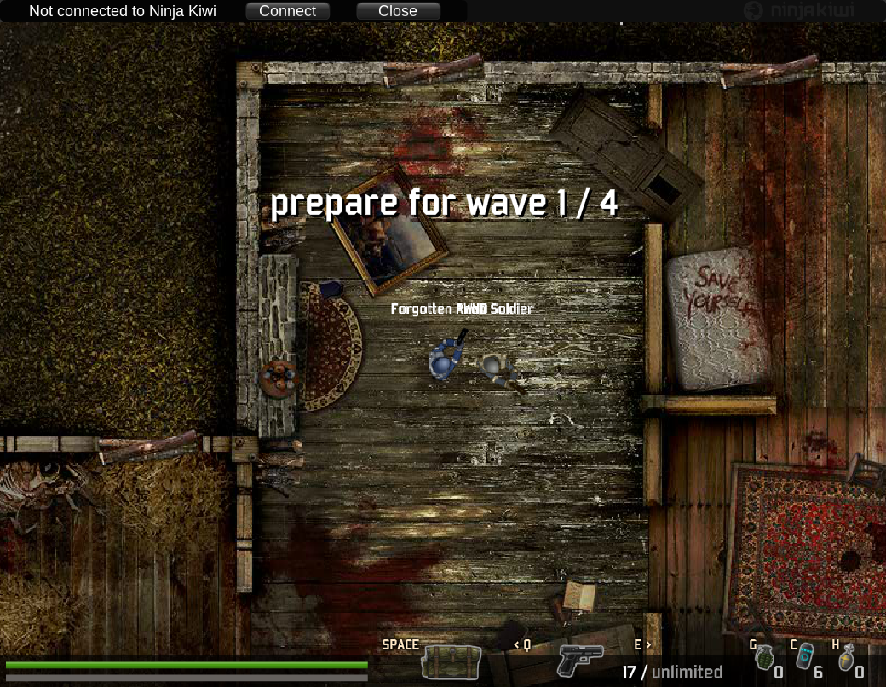
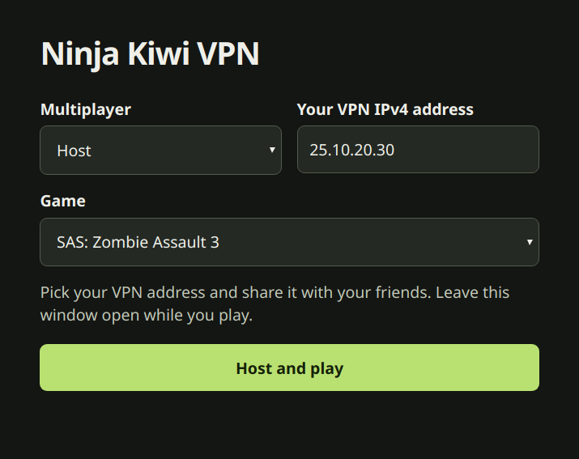
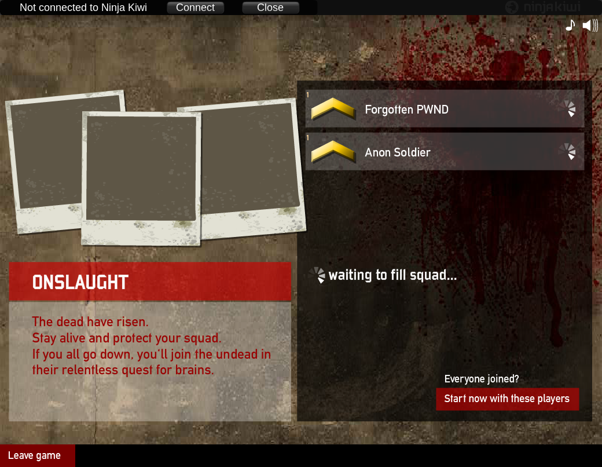

# Ninja Kiwi VPN

Play **SAS: Zombie Assault 3** co-op with friends on Linux and Windows. One
person hosts from the launcher and everyone else joins using that person's VPN IP.

## Download

| Platform | x86-64 build | First launch |
| --- | --- | --- |
| Linux | [Download AppImage](https://github.com/nickolasrm/ninja-kiwi-vpn/releases/latest/download/NinjaKiwiVPN-x86_64.AppImage) | Mark it executable in your file manager, then open it. |
| Windows | [Download EXE](https://github.com/nickolasrm/ninja-kiwi-vpn/releases/latest/download/NinjaKiwiVPN-x64.exe) | Double-click it. The first run unpacks the app into your local cache. |

Both builds include the games, Flash, Java, and the multiplayer server. For
remote play, install **one** of the VPNs below on every player's computer.
For direct downloads from this private GitHub repository, players need repository access.

## 1. Connect over a VPN

The **host's VPN IPv4 address** goes into the launcher on every computer.
On the host, it is the address of their own VPN adapter.

### Hamachi

1. Install Hamachi and bring each computer online. The Linux client uses the
   command line. After installation, run `sudo hamachi login` on Linux. [Windows download](https://vpn.net/) · [Linux download](https://vpn.net/linux)
2. On the host, choose **Network → Create a new network**. Pick a network ID
   and password. Friends choose **Network → Join an existing network** and
   enter both. On Linux, the host runs `sudo hamachi create NETWORK_ID PASSWORD`.
   Friends run `sudo hamachi join NETWORK_ID` and enter the network password.
   [Hamachi setup guide](https://lmistatic.blob.core.windows.net/document-library/logmein/pdf/en/hamachi-getting-started-guide.pdf)
3. Copy the host's Hamachi IPv4 address from the client or run
   `sudo hamachi` on the Linux host. It typically starts with `25.`. Share that
   address with your friends for the game launcher.

### Tailscale

1. Install Tailscale on every computer. The host signs in and sends each
   friend an invitation from **Users → Invite external users** in the admin
   console. Friends accept and connect their devices to that tailnet.
   [Tailscale quickstart](https://tailscale.com/docs/how-to/quickstart) · [Invite friends](https://tailscale.com/docs/features/sharing/how-to/invite-any-user)
2. Copy the host's `100.x.y.z` IPv4 address from **Machines** in the admin
   console or run `tailscale ip -4` on the host.
3. On the host, check that **Allow incoming connections** is enabled. If your
   tailnet uses custom access rules, allow your friends to reach the host on
   TCP `8044` for SAS3. [Incoming connection settings](https://tailscale.com/docs/features/client/manage-preferences)

### ZeroTier

1. Open ZeroTier Central and copy the network's 16-character **Network ID**.
   Install ZeroTier on every computer and join that network through
   **Join New Network** or `sudo zerotier-cli join NETWORK_ID` on Linux.
2. In Central, open **Member Devices** and authorize the host and each friend.
3. Copy the host's **managed IPv4 address** from the member list and share it
   for the game launcher. [ZeroTier quickstart](https://docs.zerotier.com/quickstart/)

## 2. Create a player profile

Use a name and a dedicated profile password of at least eight characters when
you host or join. The same name and password restore your progress on that
host. Use guest mode inside the Flash game. Close the game window and wait for
the launcher to confirm the save before closing the launcher or disconnecting.

The host stores profiles in `player-profiles.json` in its Ninja Kiwi VPN user
data directory. Returning to the same host preserves your progress even if
your own VPN IP changes. On first use, a local guest save can seed a new
profile. The launcher captures a backup before importing it.

### Manage host profiles

Select **Host → Manage host profiles**, then choose a player and game. The
panel can edit that game's fields after the game has produced a save.

| Game | Editable profile fields |
| --- | --- |
| SAS3 | Rank, cash, owned weapons |
| SAS4 | Character XP and cash |
| Counter Snipe | Funds, wins, losses, and combat statistics |
| Bloons TD 5 | XP and Monkey Money |
| Bloons TD Battles | Medallions |

Ask the player to close the game before editing. The changes take effect on
their next launch. If a profile changes while someone is playing, the newer
host revision takes precedence and the launcher backs up the conflicting
local save on the next connection.

Allow inbound TCP `8045` on the host's VPN interface for profile sync, in
addition to the selected game's port. Use the launcher with peers you trust.
Profile authentication and saves travel over the VPN, and the launcher uses
a separate password for these profiles.

## 3. Host or join SAS3

| Host | Friends |
| --- | --- |
| Select **Host**, enter your own VPN IPv4 address, select **SAS: Zombie Assault 3**, and click **Host and play**. Leave the launcher open while everyone plays. | Select **Join**, enter the host's VPN IPv4 address, select **SAS: Zombie Assault 3**, and click **Join and play** after the host has started. |

1. In SAS3, click **Play as guest** if the online-profile prompt appears.
2. Choose **Play → Start → Play co-op multi player**. Everyone picks the same
   mode, such as **Onslaught**, and clicks **Start new match**.
3. Wait for everyone to appear in the squad list, then click
   **Start now with these players**.

## Troubleshooting

- **Join can't reach the host.** Check that both computers are online in the
  same VPN network, the host clicked **Host and play**, and both selected the
  same game. On the host, allow inbound TCP `8044` on the VPN interface for SAS3.
  From a friend's Windows computer, run
  `Test-NetConnection HOST_IPV4 -Port 8044` in PowerShell. On Linux, run
  `nc -vz HOST_IPV4 8044` if netcat is installed. Replace `HOST_IPV4` with the
  host's VPN IP.
- **The AppImage won't open.** Run
  `chmod +x NinjaKiwiVPN-x86_64.AppImage`. On systems without FUSE, run
  `./NinjaKiwiVPN-x86_64.AppImage --appimage-extract-and-run`.
- **SAS3 asks for an online profile.** Use **Play as guest**. The launcher syncs SAS3 guest progress to the selected host.

## Games and verification

| Game | TCP lobby port | Verification |
| --- | --- | --- |
| SAS: Zombie Assault 3 | `8044` | Two-player co-op match over LAN between the packaged Linux and Windows clients |
| Counter Snipe | `7988` | Launch smoke test |
| SAS: Zombie Assault 4 | `8124` | Launch smoke test |
| Bloons TD 5 Co-op | `5577` | Launch smoke test |
| Bloons TD Battles | `4480` | Launch smoke test |

The Windows test ran under Wine. The VPN setup steps are based on the providers'
documentation. The Linux build uses Electron's `--no-sandbox` switch for
Pepper Flash compatibility. SAS4, BTD5, and Battles can allocate additional
match ports in the TCP `8127–31999` range.

Build from source

Run `./build.sh INPUTS_DIR ARCHIVE_RESOURCES_DIR` on Linux with Python 3,
Go 1.23 or newer, Git and unzip. Use the Steam Archive's `resources` directory
for the second argument. Prepare the input directory with the following files.

- `FlashPrivateServer/` at commit `dea193d18d00fa6e3a96a007500ec62ba13f5e3a` and the
  `app.zip` client from [FlashPrivateServer v5.2](https://github.com/GlennnM/FlashPrivateServer/releases/tag/v5.2).
  The server is AGPL-3.0. Its source is available from that repository, and this
  project applies its modifications in [src/patch.py](src/patch.py).
- `electron-linux.zip` and `electron-win.zip`, the Linux and Windows x64
  [Electron 8.0.1](https://github.com/electron/electron/releases/tag/v8.0.1) builds.
- `jdk/` with Temurin 17 for Linux x64 and `jre-win.zip` with the Windows x64
  JRE from [Temurin 17](https://github.com/adoptium/temurin17-binaries/releases/tag/jdk-17.0.21%2B9).
- `flashlinux/` containing `libpepflashplayer.so` and `license.pdf`, plus
  `pepflashplayer.dll` extracted from the Windows x64 Pepper installation,
  both from [Adobe Flash Player 32.0.0.371](https://archive.org/details/flashplayerarchive).
- `maps/` with the five [SAS3 map SWFs](https://github.com/sas4fs-maps/sas4fs-maps.github.io/tree/master/sas3maps).
- `appimagetool/`, the extracted x64 [appimagetool](https://github.com/AppImage/appimagetool/releases),
  and `runtime-x86_64` from the [AppImage Type 2 runtime](https://github.com/AppImage/type2-runtime/releases).

The builds and SHA-256 checksums go in `dist/`. With a SAS3 server running,
check its socket policy and handshake with `python3 tests/sas3_socket.py HOST_IPV4`.

